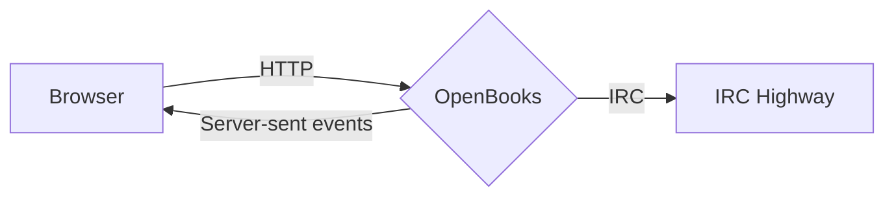
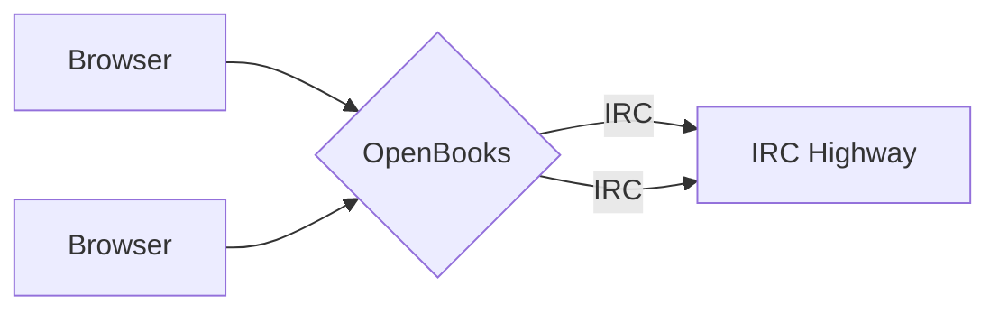

## Current

OpenBooks holds a single IRC connection, paired with a single browser client. The
browser sends requests as ordinary HTTP calls and receives IRC responses over a
[server-sent events](https://developer.mozilla.org/en-US/docs/Web/API/Server-sent_events)
stream. Opening a second tab is rejected with "Multiple connections not allowed",
because there is no way to tell which client an arbitrary IRC message belongs to.

When the event stream drops the IRC connection is held open for three minutes, so
that a page reload does not reconnect to IRC and risk a ban for connecting too
frequently.

## Future

OpenBooks would keep a pool of IRC connections and hand one to each client, so that
more than one user could be served at a time, denying the connection when the pool
is exhausted. The difficulty is the same one that limits it to a single client
today: working out from an IRC message alone which client the response belongs to.

